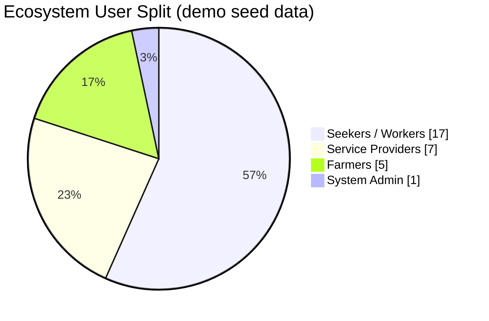
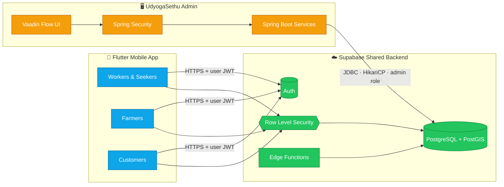
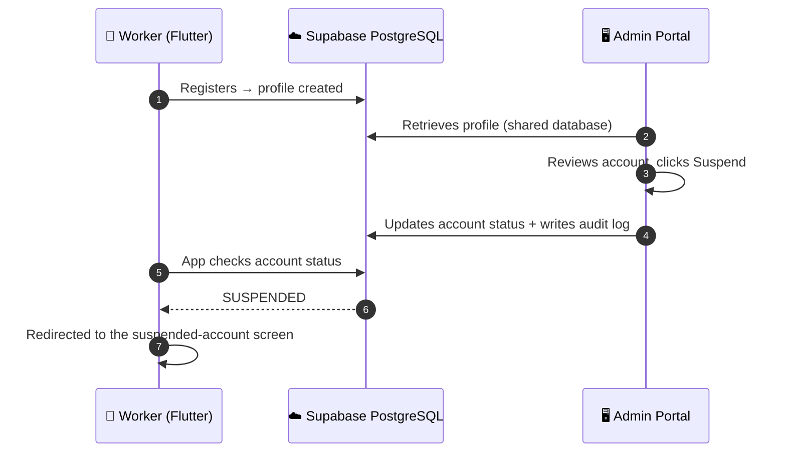
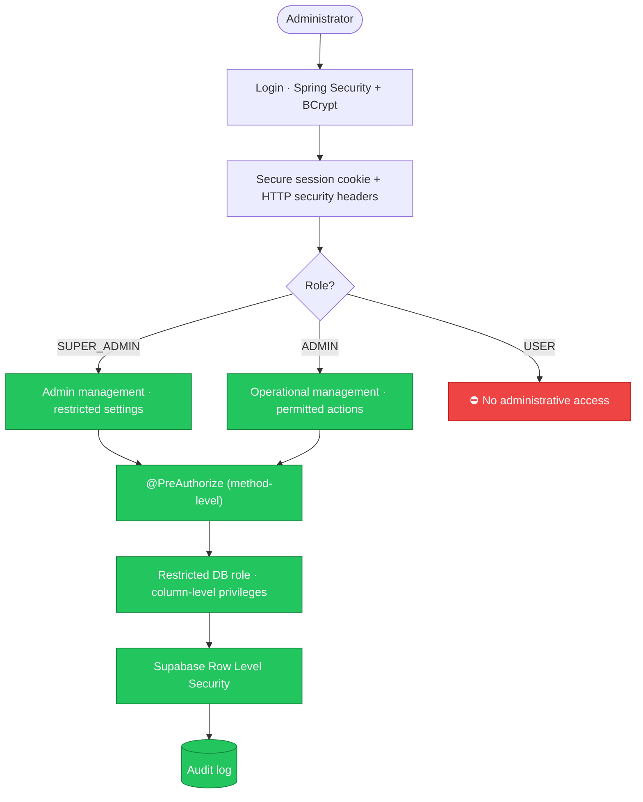

<div align="center">


<br/>


<br/>


[**Overview**](#-overview) ·
[**Live Snapshot**](#-ecosystem-at-a-glance) ·
[**Architecture**](#-architecture) ·
[**Screenshots**](#-screenshots) ·
[**Modules**](#-admin-modules) ·
[**Security**](#-security-by-design) ·
[**Getting Started**](#-getting-started)

</div>


## 🌉 Overview

**UdyogaSethu** (*Udyoga* = employment, *Setu* = bridge) is a multilingual, voice-first digital ecosystem that bridges **informal workers, job seekers, students, homemakers, service providers, employers and farmers** with local work, services and direct farm-to-customer markets.

**UdyogaSethu Admin** is the **operational control centre** of that ecosystem: a Java 21 full-stack web portal where administrators monitor activity, verify identities, moderate marketplaces, resolve disputes and keep an audit trail of every consequential decision.

> It is a **separate application** from the Flutter mobile app, yet it shares the **same Supabase backend**. Whatever an admin changes here is reflected on the mobile side. Two apps, one source of truth.

<table>
<tr>
<td width="50%" valign="top">

### 🎯 Objectives
- Centralise administration of the whole ecosystem
- Real-time visibility into activity and user growth
- Manage workers, seekers, employers, providers and farmers
- Monitor jobs, applications, produce listings and orders
- Review identity (KYC) requests and manage account status
- Handle complaints, disputes and reports
- Keep financial records **read-only** for the admin role
- Role-based access with full accountability

</td>
<td width="50%" valign="top">

### ✨ Highlights
- 🖥️ **Pure Java UI** with Vaadin Flow, no separate React/Node frontend
- 🔗 **Shared Supabase PostgreSQL** with the Flutter app
- 🛡️ **Method-level authorisation** with `@PreAuthorize`
- 🔒 **Row Level Security** plus column-level update privileges
- 💸 **Read-only finance** enforced at database-role level
- 🧾 **Audit logging** for administrative actions
- 🎙️ **Voice AI monitoring** across 5 AI providers and 8 Indic languages
- 🧪 Authorisation test suite with live Supabase integration checks

</td>
</tr>
</table>


## 📊 Ecosystem at a Glance

<div align="center">

</div>

<sub>Figures come from the seeded demonstration dataset shown in the dashboard screenshot, not from real transactions.</sub>




## 🏗️ Architecture

<div align="center">

</div>



### 🔁 Example: suspending an account end-to-end




## 📸 Screenshots

> Screens below use **seeded demonstration data**.

### 🔐 Secure Sign-In
<div align="center"></div>

### 🧭 Overview Dashboard
Eight live KPI cards, a 30-day platform activity trajectory and the ecosystem user split.
<div align="center"></div>

<table>
<tr>
<td width="50%"><b>👥 User Management &amp; Account Governance</b><br/>Server-side paged registry with search, role filter and one-click suspend.<br/></td>
<td width="50%"><b>🧰 Worker &amp; Daily Wage Seeker Registry</b><br/>Skills, daily rates, ratings, jobs completed, licences and trust badges.<br/></td>
</tr>
<tr>
<td width="50%"><b>💼 Job Management &amp; Shift Oversight</b><br/>Postings, 150 m geofence parameters, slots filled and contract states.<br/></td>
<td width="50%"><b>🌾 Produce Marketplace &amp; Crop Batches</b><br/>Crop listings, stock, reserved quantity, status and pause control.<br/></td>
</tr>
</table>

### 🪪 Identity &amp; KYC Verification Queue
Aadhaar, PAN and Driving Licence reviews with **masked identifiers**. Biometric embeddings are never rendered.
<div align="center"></div>

### 🎙️ Voice Assistant &amp; Multi-AI Orchestrator Monitoring
Telemetry across Groq, Gemini, OpenRouter, Deepgram and HuggingFace, plus Indic language distribution.
<div align="center"></div>


## 🧩 Admin Modules

| # | Module | What admins can do |
|:-:|---|---|
| 1 | 🧭 **Admin Dashboard** | Overview of users, workers, providers, farmers, jobs, applications, listings, orders and activity |
| 2 | 👥 **User Management** | Inspect profiles, monitor activity, suspend or restore accounts |
| 3 | 💼 **Jobs &amp; Applications** | Monitor postings, applications, employment activity and job status |
| 4 | 🛒 **Marketplace** | Manage service providers, farmer profiles, produce listings and availability |
| 5 | 💳 **Orders &amp; Payments** | Monitor orders, payments, payouts. Financial records are **read-only** |
| 6 | 🪪 **Identity &amp; KYC** | Review submissions, approve or reject, record reviewer decisions |
| 7 | ⚖️ **Complaints &amp; Disputes** | Investigate reports, manage resolutions, keep decision records |
| 8 | 🔔 **Notifications** | Platform announcements and administrative notifications |
| 9 | 📈 **Reports &amp; Audit Logs** | Track admin actions and maintain accountability |
| 10 | 🛡️ **Admin Management &amp; Settings** | Manage admin accounts, role permissions and configuration |


## 🔐 Security by Design



| Role | Responsibilities |
|---|---|
| `SUPER_ADMIN` | Full authority, including admin account management and restricted settings |
| `ADMIN` | Operational management, user administration and permitted platform activities |
| `USER` | No administrative privileges |

**Key measures**

- ✅ Spring Security authentication and authorisation, with BCrypt password hashing
- ✅ Method-level protection with `@PreAuthorize` (not just hidden buttons)
- ✅ Supabase **Row Level Security** and restricted, column-level database privileges
- ✅ **Read-only financial access** for the admin database role
- ✅ No direct access to biometric profiles or Supabase auth records via the admin role
- ✅ Secure session cookies, HTTP security headers, environment-based secrets
- ✅ Audit logging for administrative actions


## 🧪 Verification Status

| Area | Status |
|---|:-:|
| Java full-stack application | ✅ Implemented |
| Supabase connection | ✅ Verified |
| Shared database integration | ✅ Verified |
| Dashboard data retrieval | ✅ Tested |
| Administrative authorisation | ✅ Tested |
| RLS and database permissions | ✅ Verified |
| Financial write restrictions | ✅ Verified |
| Flutter suspension handling | 🔎 Confirmed by code inspection |
| Maven authorisation tests | ✅ 13 passed, 0 failures |
| SMS OTP / Google OAuth end-to-end | ⏳ Not yet tested |


## 🛠️ Tech Stack

| Layer | Technology |
|---|---|
| Language | Java 21 |
| Backend framework | Spring Boot 3.3.5 |
| Web UI | Vaadin Flow 24.4.12 |
| Build | Maven |
| Database | Supabase PostgreSQL |
| Connectivity | JDBC, HikariCP |
| Auth | Spring Security, BCrypt |
| Migrations | Flyway |
| Testing | JUnit, Spring Boot Test |
| IDE | Antigravity |


## 🚀 Getting Started

**Prerequisites:** JDK 21, Maven 3.9+, and a Supabase project (the same one used by the Flutter app).

```bash
# 1. Clone
git clone https://github.com/chethankp365/<your-repo-name>.git
cd <your-repo-name>

# 2. Configure secrets via environment variables (never commit them)
export SUPABASE_DB_URL="jdbc:postgresql://<host>:5432/postgres"
export SUPABASE_DB_USER="<restricted-admin-db-role>"
export SUPABASE_DB_PASSWORD="<password>"

# 3. Run tests
mvn test

# 4. Start the portal
mvn spring-boot:run
```

Then open **http://localhost:8080** and sign in with an authorised admin account.

> ⚠️ The variable names above are examples. Match them to the properties used in your `application.properties`. Use a **restricted database role**, never the Supabase service key.


## 🔭 Roadmap

- [ ] End-to-end tests for SMS OTP and Google OAuth sign-in
- [ ] Wider reporting and export options
- [ ] Deeper analytics for both marketplaces
- [ ] Load testing before production deployment

## 📚 Research Context

UdyogaSethu is described in the paper **"UdyogaSethu: A Smart Digital Ecosystem for Informal Workforce Empowerment and Agricultural Market Integration"**, Atria Institute of Technology, Bengaluru. This repository is the separately deployed **administrator application** described there. It uses an administrator role, holds no privileged service key, and writes consequential actions to an audit log.

## 👨‍💻 Author

<div align="center">

**Chethan Kumar KP** · Department of Computer Science and Design, Atria Institute of Technology, Bengaluru

[](https://github.com/chethankp365)
[](https://linkedin.com/in/chethan-kumar-kp17)

<br/>


<sub>Built with ☕ Java, 🌱 Supabase and a lot of purpose · bridging work, farms and people.</sub>

</div>
