# UdyogaSethu Admin — Schema Discovery & Architecture Audit

> **Platform**: PostgreSQL 15.6 on Supabase (`mmzbpeqkfomnywuzoqii`)  
> **Source of Truth**: 107 SQL Migrations (`supabase/migrations/0000_ping.sql` – `0811_chat_rpc_and_storage.sql`), Flutter `lib/`, and backend service layer at `D:\Projects\Udyoga Sethu`.

---

## 1. Executive Summary

The UdyogaSethu database architecture comprises **75 relational tables** organized across 8 primary business domains. It features PostGIS geospatial indexing (`GEOGRAPHY(POINT, 4326)`), double-entry immutable ledger accounting (`public.ledger_entries`), row-level security (RLS) with security definer functions, and real-time WebSocket replication for field workers, providers, and farmers.

---

## 2. Entity Relationship Diagram (Mermaid)

```mermaid
erDiagram
    PROFILES ||--o| WORKER_PROFILES : "1:1 extended profile"
    PROFILES ||--o| PROVIDER_PROFILES : "1:1 extended profile"
    PROFILES ||--o| FARMER_PROFILES : "1:1 extended profile"
    PROFILES ||--o{ ADDRESSES : "1:N user locations"
    PROFILES ||--o| WALLETS : "1:1 financial container"
    PROFILES ||--o| FACE_PROFILES : "1:1 biometric template"
    PROFILES ||--o{ USER_ROLES : "1:N role assignments"

    JOBS ||--o{ JOB_APPLICATIONS : "1:N applications"
    JOBS ||--o{ JOB_ASSIGNMENTS : "1:N shift contracts"
    PROFILES ||--o{ JOBS : "posts jobs (provider/farmer)"
    WORKER_PROFILES ||--o{ JOB_APPLICATIONS : "submits"
    WORKER_PROFILES ||--o{ JOB_ASSIGNMENTS : "contracts"
    JOB_ASSIGNMENTS ||--o{ ASSIGNMENT_EVENTS : "audit history"
    JOB_ASSIGNMENTS ||--o{ ATTENDANCE_LOGS : "QR scans"

    FARMER_PROFILES ||--o{ PRODUCE_LISTINGS : "catalogs crops"
    PRODUCE_LISTINGS ||--o{ PRODUCE_LOTS : "quality lots"
    PRODUCE_LISTINGS ||--o{ SUBSCRIPTIONS : "milk/veggie recurring"
    PROFILES ||--o{ ORDERS : "places orders"
    ORDERS ||--o{ ORDER_ITEMS : "contains produce"
    ORDERS ||--o{ ORDER_EVENTS : "delivery lifecycle"

    WALLETS ||--o{ LEDGER_ENTRIES : "immutable credits/debits"
    PROFILES ||--o{ PAYMENTS : "gateway transactions"
    WALLETS ||--o{ PAYOUTS : "bank withdrawals"

    PROFILES ||--o{ RATINGS_REVIEWS : "reviews and feedback"
    PROFILES ||--o{ DISPUTES : "grievances"
    DISPUTES ||--o{ DISPUTE_EVIDENCE : "supporting files"
    PROFILES ||--o{ NOTIFICATIONS : "in-app notifications"
    PROFILES ||--o{ USER_DEVICE_TOKENS : "FCM push tokens"
```

---

## 3. Table Inventory & Domain Catalog

### 3.1 Domain 1: Identity, Auth & Profiles
| Table | Primary Key | Foreign Keys | Key Columns | Purpose |
| :--- | :--- | :--- | :--- | :--- |
| `public.profiles` | `id` (UUID) | `auth.users(id)` | `phone`, `full_name`, `language`, `active_role` (`app_role`), `avatar_path`, `daily_earnings_goal_paise`, `is_suspended` | Master identity profile linked to Supabase Auth. |
| `public.worker_profiles` | `user_id` (UUID) | `profiles(id)` | `seeker_type`, `bio`, `hourly_rate_paise`, `daily_rate_paise`, `working_days`, `has_driving_licence`, `rating_avg`, `jobs_completed_count`, `is_verified_badge` | Worker-specific qualifications, rates, and verified badge. Guard trigger protects stats. |
| `public.provider_profiles` | `user_id` (UUID) | `profiles(id)` | `provider_type`, `categories_hiring`, `typical_crew_size`, `is_verified_badge` | Household or employer hiring details. |
| `public.farmer_profiles` | `user_id` (UUID) | `profiles(id)` | `farm_name`, `cluster_name`, `total_land_acres`, `primary_crops`, `delivery_radius_km`, `pickup_available`, `organic_cert_number` | Farmer operational profile, crops, land, and delivery radius. |
| `public.addresses` | `id` (UUID) | `user_id -> profiles(id)` | `address_text`, `landmark`, `location` (Point 4326), `is_default` | Physical locations with PostGIS spatial point. |
| `public.user_roles` | `(user_id, role)` | `user_id -> profiles(id)` | `role` (`app_role`) | Multi-role assignment (seeker, provider, farmer). |

### 3.2 Domain 2: Jobs, Applications & Attendance Execution
| Table | Primary Key | Foreign Keys | Key Columns | Purpose |
| :--- | :--- | :--- | :--- | :--- |
| `public.jobs` | `id` (UUID) | `provider_id -> profiles(id)`, `category_id -> categories(id)` | `title`, `wage_type`, `wage_paise`, `slots_total`, `slots_filled`, `start_at`, `location`, `geofence_radius_m` (default 150), `status` (`job_status`), `suitable_for`, `thumbnail_path` | Job listings with 150m geofence radius. |
| `public.job_applications`| `id` (UUID) | `job_id -> jobs(id)`, `worker_id -> profiles(id)` | `status` (`application_status`), `note`, `created_at` | Worker applications. Unique index prevents duplicates per worker/job. |
| `public.job_assignments` | `id` (UUID) | `job_id`, `worker_id`, `provider_id` | `booking_code`, `agreed_wage_paise`, `status` (`assignment_status`), `started_at`, `ended_at`, `elapsed_seconds`, `start_selfie_path`, `payment_eligible` | Contracted work execution shift. |
| `public.assignment_events`| `id` (UUID)| `assignment_id -> job_assignments(id)` | `status_from`, `status_to`, `actor_id`, `created_at`, `metadata` | Audit trail for assignment state transitions. |
| `public.attendance_logs` | `id` (UUID) | `assignment_id`, `scanner_id`, `token_id` | `scanned_at`, `scanner_location` | Physical QR check-in scan records. |
| `public.qr_tokens` | `id` (UUID) | `user_id`, `assignment_id` | `token_hash`, `purpose`, `expires_at`, `used`, `used_at` | Cryptographic HMAC attendance and identity tokens. |

### 3.3 Domain 3: Agri-Commerce, Farm Produce & Orders
| Table | Primary Key | Foreign Keys | Key Columns | Purpose |
| :--- | :--- | :--- | :--- | :--- |
| `public.produce_listings`| `id` (UUID) | `farmer_id -> profiles(id)` | `crop_name`, `category`, `price_per_unit_paise`, `unit`, `stock_qty`, `reserved_qty`, `harvest_date`, `farming_method`, `status` (`produce_status`) | Crop listings offered by farmers. |
| `public.produce_lots` | `id` (UUID) | `listing_id -> produce_listings(id)` | `lot_number`, `lot_token`, `agronomist_notes`, `signature` | Cryptographic lot traceability records. |
| `public.orders` | `id` (UUID) | `customer_id`, `farmer_id`, `slot_id` | `order_code`, `total_paise`, `platform_fee_paise`, `status` (`order_status`), `handover_pin` | Farm produce orders. |
| `public.order_items` | `id` (UUID) | `order_id -> orders(id)`, `listing_id` | `quantity`, `unit_price_paise`, `total_price_paise` | Line items for each order. |
| `public.order_events` | `id` (UUID) | `order_id -> orders(id)` | `status_from`, `status_to`, `actor_id`, `note`, `created_at` | Order fulfillment timeline. |
| `public.subscriptions` | `id` (UUID) | `customer_id`, `listing_id` | `frequency`, `quantity`, `next_delivery_date`, `status` | Daily/weekly recurring deliveries (milk, vegetable boxes). |
| `public.group_orders` | `id` (UUID) | `listing_id`, `organizer_id` | `target_qty`, `current_qty`, `deadline`, `status` | Apartment bulk buying pools. |
| `public.resource_listings`| `id` (UUID)| `owner_id -> profiles(id)` | `title`, `resource_type`, `hourly_rate_paise`, `daily_rate_paise` | Equipment rental (tractors, drones, harvesters). |
| `public.resource_bookings`| `id` (UUID)| `resource_id`, `renter_id` | `start_at`, `end_at`, `total_paise`, `status` | Equipment rental bookings with escrow. |

### 3.4 Domain 4: Financial Vault & Immutable Ledger
| Table | Primary Key | Foreign Keys | Key Columns | Purpose |
| :--- | :--- | :--- | :--- | :--- |
| `public.wallets` | `id` (UUID) | `user_id -> profiles(id) UNIQUE` | `currency`, `is_frozen` | Wallet record. Balances derived from ledger. |
| `public.ledger_entries` | `id` (UUID) | `wallet_id -> wallets(id)` | `direction` (`credit`/`debit`), `bucket` (`available`/`escrow`/`reward`), `amount_paise`, `entry_type`, `ref_type`, `ref_id`, `balance_after_paise` | Immutable double-entry ledger. **Trigger `trg_prevent_ledger_mutation` blocks UPDATE and DELETE.** |
| `public.payments` | `id` (UUID) | `payer_id -> profiles(id)` | `amount_paise`, `platform_fee_paise`, `protection_fee_paise`, `status` (`payment_status`), `razorpay_order_id`, `razorpay_payment_id`, `receipt_no` | Gateway payment transactions. |
| `public.payouts` | `id` (UUID) | `wallet_id -> wallets(id)` | `amount_paise`, `method`, `status` (`payout_status`), `utr_number` | Bank account withdrawals. |
| `public.payment_webhook_events` | `id` (UUID) | None | `event_id`, `event_type`, `payload`, `processed` | Idempotency log for Razorpay webhooks. |

### 3.5 Domain 5: Trust, KYC, Biometrics & Disputes
| Table | Primary Key | Foreign Keys | Key Columns | Purpose |
| :--- | :--- | :--- | :--- | :--- |
| `public.face_profiles` | `id` (UUID) | `user_id -> profiles(id) UNIQUE` | `reference_photo_path`, `embedding` (FLOAT8[]), `enrolled_at` | Face template. **Zero embeddings exposed to UI. Signed URLs only.** |
| `public.verification_attempts` | `id` (UUID) | `user_id`, `reviewer_id` | `context`, `result`, `confidence_score`, `failure_reason` | Audit trail of biometric and document checks. |
| `public.kyc_records` | `id` (UUID) | `user_id -> profiles(id)` | `doc_type`, `doc_number_masked`, `doc_photo_path`, `status`, `rejection_reason` | Aadhaar/PAN/DL document verification records. |
| `public.ratings_reviews`| `id` (UUID) | `reviewer_id`, `reviewee_id`, `assignment_id` | `rating` (1-5), `tags` (TEXT[]), `comment` | Mutual peer reviews. |
| `public.disputes` | `id` (UUID) | `assignment_id`, `complainant_id`, `respondent_id` | `category`, `reason`, `status`, `resolution_notes`, `refund_amount_paise` | Formal grievance reporting with escrow freezing. |
| `public.dispute_evidence` | `id` (UUID) | `dispute_id -> disputes(id)` | `uploader_id`, `file_path`, `description` | Supporting photos and documents for disputes. |
| `public.emergency_contacts` | `id` (UUID) | `user_id -> profiles(id)` | `contact_name`, `contact_phone`, `relationship` | Safety center contacts. |
| `public.sos_incidents` | `id` (UUID) | `user_id -> profiles(id)` | `location`, `status`, `trigger_type`, `resolved_at` | Emergency SOS triggers. |

### 3.6 Domain 6: Realtime Communication & Notifications
| Table | Primary Key | Foreign Keys | Key Columns | Purpose |
| :--- | :--- | :--- | :--- | :--- |
| `public.conversations` | `id` (UUID) | `participant1_id`, `participant2_id`, `job_id` | `last_message_at`, `is_demo` | In-app chat threads. |
| `public.messages` | `id` (UUID) | `conversation_id -> conversations(id)`, `sender_id` | `content` (auto-masked for phone/UPI by trigger), `is_read`, `created_at` | Protected chat messages. |
| `public.notifications` | `id` (UUID) | `user_id -> profiles(id)` | `title`, `body`, `type`, `data` (JSONB), `is_read`, `created_at` | In-app notification center alerts. |
| `public.user_device_tokens` | `id` (UUID) | `user_id -> profiles(id)` | `fcm_token`, `platform`, `updated_at` | Push notification device registration. |

---

## 4. User Roles & Enums Actually Used

### User Roles (`public.app_role`):
1. `seeker` — Job seekers, daily wage workers, students, and informal laborers.
2. `provider` — Household employers, small business owners, and contractors posting jobs.
3. `farmer` — Smallholder agricultural producers listing crops and hiring seasonal farm labour.
4. `admin` — Legacy system administrator role.

### Seeker Types (`public.seeker_type`):
`informal`, `student`, `part_time`.

### Provider Types (`public.provider_type`):
`household`, `employer`.

### Job Statuses (`public.job_status`):
`draft`, `open`, `filled`, `closed`, `cancelled`.

### Job Application Statuses (`public.application_status`):
`applied`, `shortlisted`, `rejected`, `withdrawn`, `hired`.

### Assignment Statuses (`public.assignment_status`):
`requested`, `accepted`, `ticket_issued`, `arrived`, `in_progress_verified`, `completed`, `payment_released`, `cancelled`, `no_show`, `disputed`.

### Produce Statuses (`public.produce_status`):
`active`, `low_stock`, `sold_out`, `paused`.

### Order Statuses (`public.order_status`):
`pending`, `accepted`, `packed`, `out_for_delivery`, `delivered`, `cancelled`, `disputed`.

### Payment Statuses (`public.payment_status`):
`created`, `authorised`, `captured`, `held`, `released`, `refunded`, `failed`.

### Verification Statuses (`public.verification_status`):
`not_started`, `pending`, `verified`, `rejected`, `review_required`.

---

## 5. Module Backing Matrix (The 18 Admin Modules)

| # | Admin Module | Backing Tables & Functions | Status | Notes |
| :--- | :--- | :--- | :--- | :--- |
| **1** | **Overview Dashboard** | `profiles`, `jobs`, `produce_listings`, `orders`, `payments`, `disputes`, `verification_attempts` | **Fully Supported** | Real KPI counts, trends, and recent audit activity. |
| **2** | **User Management** | `profiles`, `addresses`, `user_roles` | **Fully Supported** | Server-side paged grid, filter by role/status, suspend/restore with audit reason. |
| **3** | **Worker Management** | `worker_profiles`, `profiles`, `ratings_reviews`, `job_assignments` | **Fully Supported** | Skills, daily/hourly rates, driving licence, completed jobs, trust score. |
| **4** | **Service Providers** | `provider_profiles`, `profiles`, `jobs` | **Fully Supported** | Household vs employer type, categories hiring, crew size, verification. |
| **5** | **Job Management** | `jobs`, `job_applications`, `job_assignments`, `attendance_logs` | **Fully Supported** | Geofence radius, applicants list, assignments. Must preserve Apply flow integrity! |
| **6** | **Farmer Management** | `farmer_profiles`, `profiles`, `produce_listings` | **Fully Supported** | Farm name, cluster, acreage, crops, delivery radius, organic cert. |
| **7** | **Produce Marketplace** | `produce_listings`, `produce_lots`, `farmer_profiles` | **Fully Supported** | Crop categories, pricing (paise/kg), stock vs reserved, lot traceability token. |
| **8** | **Orders Management** | `orders`, `order_items`, `order_events` | **Fully Supported** | 7-stage order status, handover PIN, customer and farmer details. |
| **9** | **Payments & Transactions**| `payments`, `payouts`, `ledger_entries`, `wallets`, `admin.demo_transactions` | **Fully Supported** | Gateway payments, ledger double-entry. Demo data isolated in `admin.demo_transactions`. |
| **10** | **Identity Verification** | `kyc_records`, `verification_attempts`, `face_profiles` | **Fully Supported** | View document images via signed URLs. **Zero embedding display.** |
| **11** | **Reviews & Ratings** | `ratings_reviews`, `profiles`, `job_assignments` | **Fully Supported** | Peer rating scores (1-5), review comments, quick tags. Moderation actions audited. |
| **12** | **Complaints & Disputes** | `disputes`, `dispute_evidence`, `job_assignments` | **Fully Supported** | Escalation workflow: Open -> Under Review -> Escalated -> Resolved. |
| **13** | **Voice Assistant Monitoring**| Edge Function logs (`ai-assist`), DB query | **Partially Supported** | Call counts, language codes, latency, provider routing. **Raw audio is NOT stored in DB** (designed "Not available in current data model" badge displayed). |
| **14** | **Notifications** | `notifications`, `user_device_tokens` | **Fully Supported** | Sent notification history and audience preview composer. |
| **15** | **Reports & Analytics** | Aggregation views across `jobs`, `orders`, `payments`, `profiles` | **Fully Supported** | Server-side aggregations with CSV and PDF generation. |
| **16** | **Admin Management** | `admin.admin_users`, `admin.roles`, `admin.permissions` | **Fully Supported (via Admin Schema)** | Dedicated Flyway migration adds isolated admin tables. |
| **17** | **Audit Logs** | `admin.audit_logs` | **Fully Supported (via Admin Schema)** | Immutable append-only audit trail with diff viewer. |
| **18** | **Settings** | `admin.admin_users`, Spring Actuator, Storage client | **Fully Supported** | Theme preferences, reduce-motion toggle, Actuator health status. |

---

## 6. The Mobile "Apply" Flow — Invariant Analysis & Protection

### Flow Mechanics in Mobile App:
1. Worker navigates to a job in `JobFeedScreen` and clicks **Apply**.
2. Mobile calls canonical RPC `public.apply_to_job(p_job_id UUID, p_message TEXT)` (migration `0780`).
3. Inside `apply_to_job`:
   - Checks authentication (`auth.uid()`).
   - Checks idempotency: if an application already exists with status `!= 'withdrawn'`, returns the existing application ID immediately.
   - Evaluates worker eligibility via `public.check_job_eligibility(p_job_id)`:
     - Worker must have an active seeker profile.
     - Prerequisite check: driving licence (`has_driving_licence`) if required by job.
     - Prerequisite check: verified badge (`is_verified_badge`) if required.
     - Schedule conflict check: no active overlapping shift in `job_assignments`.
     - Audience / suitable_for check: worker type (`informal`, `student`, `part_time`) must be in `suitable_for`.
     - Capacity check: `slots_filled < slots_total` and job status is `open`.
   - Inserts row into `public.job_applications` with status `'applied'`.
   - Increments or triggers provider notification.

### Critical Admin Rules:
- **Never alter the status enum `application_status` or remove `'applied'`/`'hired'`.**
- **Never manually update `jobs.slots_filled` without updating assignments**, as the mobile app validates slot consistency.
- **Admin operations on jobs (pause, cancel, close) must check existing active applications and notify workers gracefully.**

---

## 7. RLS Policy Considerations for Admin Access
The mobile app relies heavily on RLS policies checking `auth.uid() = user_id`.
For the **UdyogaSethu Admin** application:
1. We do **NOT** use `service_role` as an unmonitored blanket bypass.
2. We create a dedicated PostgreSQL role `udyogasethu_admin_app` with explicit table-level grants.
3. For tables with RLS enabled, the admin connection either queries through role-level bypass or explicitly configured admin policies (`public.is_admin()` or role membership), ensuring every action is audited.
